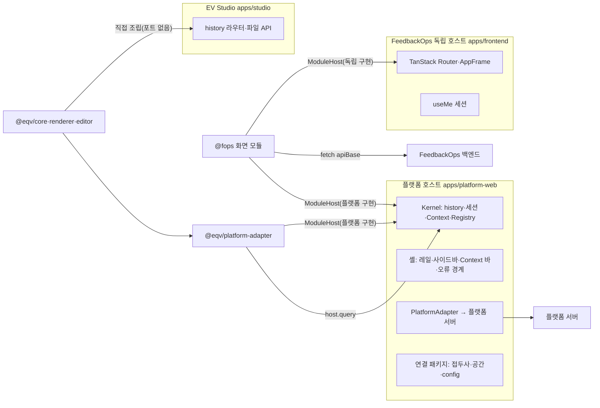
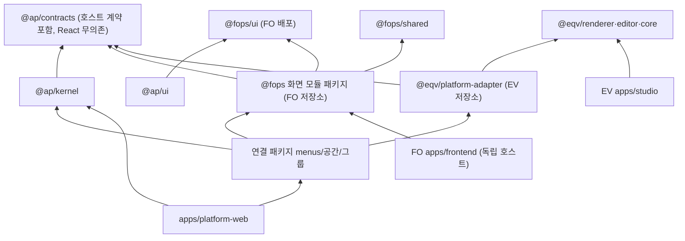

# 플랫폼 탑재 설계 — 한 업무 모듈, 두 호스트 (equipment-visualization · FeedbackOps)

> 상태: **Proposed (선행 조사, 구현 안 함)** — 2026-10-17 작성. 다른 저장소의 업무 모듈(equipment-visualization, FeedbackOps)이 플랫폼 셸 안에 탑재될 때 무엇을 선언하고 무엇을 받는지(호스트 인터페이스), 같은 모듈이 독립 호스트에서도 도는 방법, 저장소·패키지 배치를 정한 **후보 설계**다. 장래 SDK([#396](https://github.com/hjung3113/analytics-platform/issues/396))의 핵심 인터페이스 초안이기도 하다. 구현 지시가 아니고 현행 계약 원본(06·[패키지 경계](platform-packages.md)·ADR)을 바꾸지 않는다. 결정 초안은 [ADR-0038](../adr/0038-host-module-contract-and-feedbackops-mounting.md)(호스트 계약 + FeedbackOps 탑재, 채택 시 ADR-0027 대체)과 [ADR-0039](../adr/0039-equipment-visualization-platform-first-host-contract.md)(EV 플랫폼 우선)이며 둘 다 Proposed다. 추적 이슈: [#402](https://github.com/hjung3113/analytics-platform/issues/402).
>
> **§2 호스트 인터페이스는 [ADR-0053](../adr/0053-host-module-contract-v1.md)이 1판으로 확정했다(2026-10-19).** 그 ADR이 이 문서 §2·§4의 해당 부분보다 우선한다(모듈 패키지 의존 범위: `@ap/contracts`·`@ap/ui`).
>
> SDK 목표는 [ADR-0043](../adr/0043-platform-sdk-is-the-app-contract-and-unified-framework.md)를 따른다: 호스트 → 모듈 계약은 SDK의 중심이고, 아래 "독립 호스트" 쪽은 각 제품의 선택이며 SDK 범위가 아니다. `@fops/ui` 배포·peer 전제(§0, §2 G10, §3·§4 그림과 표, §5.6, §8 H2)는 ADR-0043이 뒤집었다. §4의 "모듈 패키지는 `@ap/contracts`만 import"도 "앱이 SDK 프레임워크를 소비한다"와 맞지 않아 SDK 배포 단위를 설계할 때 다시 정한다(Open).
>
> 사실은 2026-10-17에 읽은 파일·이슈에서 왔고 [§9 출처](#9-출처)에 모았다. 읽지 않은 것에서 끌어낸 판단은 **추정**으로 표시했다. 지도 역할의 앞 문서는 [프레임워크 통합 계획](framework-unification-plan.md)(단계 0–5)이고, 이 문서는 그 단계 2(EV 첫 실소비자)·단계 5(두 번째 호스트)의 호스트 인터페이스를 구체화한다.

## 0. 한 장 요약

- **오늘 정해진 전제(사용자, 2026-10-17):** EV는 플랫폼 탑재가 기본이고 독립 Studio는 부가 기능이다. 호스트 → 모듈 계약은 플랫폼이 `@ap/contracts`로 내고, EV는 `packages/platform-adapter` 안에서만 `@ap/*`에 의존한다(#332·#396 코멘트). #148은 A(TS 원본). `@fops/ui`는 FeedbackOps가 배포하고 `@ap/ui`가 peer로 의존한다. EV 편입은 서브모듈 고정 + `@eqv/*` workspace 패키지만.
- **권고 모양:** 모듈은 **화면 manifest**(React 무의존 메타데이터: 화면 id·모듈 상대 경로·권한·page key·Context capability·pageType·계약 버전·필수 기능)와 **화면 컴포넌트**를 낸다. 호스트는 화면마다 **호스트 포트 하나**(`ModuleHost`, 이름 Candidate)를 준다: 세션 스냅샷과 세대, 권한 표시 판정, 모듈 상대 내비게이션·page 상태·복귀, 전역 Context 읽기, 플랫폼 서버 조회(선택), 조립 설정값, 언어, 알림, 오류 보고, 구독, 해제 신호. 지금 `MenuMeta`·`EndpointSpec`·`GlobalContext`·`ApiResponse`·`resolveLink`·`returnTarget`·`reportError`가 이 계약의 대부분이고, 빠진 것은 **열린 어휘(그룹·권한)**, **모듈 경로 접두사**, **React 밖에서 쓰는 호스트 포트**, **모듈 상태(인증 필요·신원 불일치)**, **조립 설정 주입**, **계약 버전 검사**다(§2.4).
- **두 호스트:** 플랫폼 셸에서는 Kernel이 `usePlatform()`으로 호스트 포트를 만들고, 독립 호스트에서는 제품 앱이 같은 포트를 자기 라우터·세션으로 구현한다. **EV**는 Studio가 포트를 구현할 필요가 없다 — Studio는 `@eqv/core`·`renderer`·`editor`를 직접 조립하는 저작 도구로 남고, 플랫폼 탑재 화면은 `platform-adapter`가 만든다. **FeedbackOps**는 독립 앱이 계속 1차 호스트인 사용자(담당자·관리자·허브)가 있으므로, 독립 앱도 같은 화면 모듈을 포트로 조립해야 화면이 한 벌로 남는다(§3).
- **FeedbackOps 권고:** **한 원본, 두 호스트(D)**. FeedbackOps가 화면을 모듈 패키지로 옮기고 독립 앱과 플랫폼 협업 공간이 같은 화면을 조립한다. 백엔드·권한·Managed System 규칙은 FeedbackOps 소유. 파일럿은 설문 참여·응답(`/surveys/participate`·`/surveys/$surveyId/respond`) — Managed System 범위·상세 패널이 없는 작은 흐름으로 인증·쓰기·복귀를 먼저 검사하고, 다음 단계(신고자 VOC 흐름)에서 플랫폼이 따로 그리는 1단계 읽기 화면(`/voc` 내 VOC)을 원본 화면으로 바꾼다. ADR-0027은 채택 시 ADR-0038이 대체한다(§5).
- **패키지 배치:** 모듈 코드는 제품 저장소에 두고, 플랫폼은 서브모듈 고정 + 지정한 workspace 패키지만 포함한다(FO·EV 같은 절차). 모듈 패키지는 `@ap/contracts`만 import한다. 저장소 순환(플랫폼이 FO를 서브모듈로, FO가 `@ap/contracts`를 필요로 함)은 **`@ap/contracts`를 먼저 배포**해서 끊는다(§4).
- **선행:** FeedbackOps MVP 릴리스, 같은 사이트 배포와 세션(#150·#151), `@ap/contracts` 배포 경로, 협업 공간 셸 시안 컨펌. 사용자 질문 10개와 권고는 [§7](#7-위험선행사용자-질문).

## 1. 범위와 용어

| 용어 | 뜻(이 문서) |
| --- | --- |
| **모듈** | 다른 저장소가 소유하는 업무 화면 묶음. 화면 manifest + 화면 컴포넌트 + 자기 도메인 코드. 예: EV Top View 뷰어·재생, FeedbackOps VOC·Task·설문 화면 |
| **호스트** | 한 브라우저 실행 트리에서 history·세션·전역 Context·알림·상세 슬롯을 소유하고 모듈 화면을 조립하는 앱. 플랫폼 셸(`apps/platform-web`), FeedbackOps 독립 앱, EV Studio |
| **호스트 포트** | 호스트가 화면에 주는 React 무의존 객체(`ModuleHost`, Candidate). 서버 포트 `PlatformAdapter`와 다른 층이다 — `PlatformAdapter`는 Kernel → 플랫폼 서버, 호스트 포트는 호스트 → 모듈 화면 |
| **연결 패키지** | 플랫폼 쪽에서 모듈 manifest를 Registry에 이어 붙이고 공간·그룹·설정값을 정하는 얇은 패키지(화면 코드 없음) |

범위 밖: 운영 중 원격 로딩·플러그인 설치(06 §14 Deferred, #396 §1), 신뢰되지 않는 코드 격리(#396 §7 — 같은 JS 실행 환경의 모듈은 신뢰된 코드), 백엔드 통합(제품 서버는 각자 소유).

## 2. 호스트 인터페이스 (질문 1)

### 2.1 모듈이 선언하는 것 — 화면 manifest

지금 메뉴는 `MenuEntry = MenuMeta + icon + component`를 그룹 패키지에서 내고 앱이 `createRegistry`로 검증한다([06 §5](../06_platform_ui_contract.md#5-menu-extension-contract), [패키지 경계 §5](platform-packages.md#5-메뉴-패키지-계약과-템플릿)). 모듈 manifest는 이 선언을 **모듈 단위로 묶고 호스트가 정할 것을 뺀** 모양이다.

| 선언 | 모듈이 정함 | 호스트(조립)가 정함 | 현재 타입 | EV 예 | FeedbackOps 예 |
| --- | --- | --- | --- | --- | --- |
| 모듈 식별·계약 버전 | `module.id`, `contract: 1`, 필수·선택 호스트 기능 | 받아들일 계약 버전 | 없음 | `equipment-visualization` | `feedbackops` |
| 화면 | 화면 id, **모듈 상대 경로**, 이름·설명(`Text`), pageType, `navHidden`·`parent`(모듈 안) | 경로 접두사(예 `/equipment/topview`, `/collab`), 아이콘 매핑 | `MenuMeta`(경로는 앱 절대 경로) | `topview`·`replay` | `voc-create`·`vocs`·`voc-detail`·`tasks`… |
| 그룹 | 모듈 안 묶음(사이드바 섹션 후보) | 어느 공간에 둘지(`GroupDef.space`), 그룹 id | `GroupDef`(id는 닫힌 `GroupId`) | 기존 `equipment` 그룹에 합침 | `voc`·`task`·`survey` 묶음 |
| 권한 | 화면·조회의 권한 문자열(모듈 접두사) | 그 문자열을 세션 권한에 싣는 것(서버) | `Permission`(닫힌 목록 8개) | `equipment:view`(기존), `equipment:topview:edit`·`equipment:replay:view` 후보(미승인) | FeedbackOps capability를 표시용으로 투영 |
| page key | 등록 키, `contextResetKeys`, `returnTo` 수용 여부 | — | `pageKeys` 등 | `at`, `anchor`, `layoutRevision` | `view`·`selected`·`managedSystem`·`action` |
| Context capability | 8개 키별 `apply`/`reference`/`unsupported`, `requiresScope` | — | `context`, `requiresScope` | `time: apply`, `selection: reference` | 전부 `unsupported`, `requiresScope: false` |
| 데이터 | 플랫폼 서버 조회면 `EndpointSpec`; 제품 서버면 "자기 API 사용"과 필요한 설정 키 | 엔드포인트의 서버 사본, 제품 API 기준 경로 | `EndpointSpec`·`defineEndpoint` | `equipment.topview.*` 4종 | 없음(FeedbackOps API, `apiBase` 설정) |

### 2.2 모듈이 받는 것 — 호스트 포트

| 관심사 | 플랫폼 호스트가 주는 것 | 지금 있는 것 | 비고 |
| --- | --- | --- | --- |
| Registry 진입 | 화면을 메뉴로 등록, 사이드바·팔레트·breadcrumb·권한 숨김·미구현 표시 | `createRegistry`, 셸 | 모듈은 사이드바 JSX를 만들지 않는다(06 §5 금지) |
| 경로·page key | 화면 매칭 params, 등록 page key 값(읽기), `setPage`(push/replace), 모듈 안 이동 `href`/`navigate`, 다른 메뉴로 `linkTo`(menuId) | `route.params`, `pageParam`, `setPage`, `navigate`, `resolveLink` | URL 문자열을 모듈이 조립하지 않는다(06 §22). 모르는 키·형식 오류는 보정하지 않고 거부(06 §6.4) |
| 전역 Context | 선언한 `apply`·`reference` 키의 현재 값과 미적용 표시. 1판 의미(Decided, 코디네이터): `host.context()`는 `time`→`from`·`to`, `roomNames`, `line`→`lineNames`, `prcGroup`→`prcGroups`+`membershipBasis`, `condition`→`condition`+`membershipBasis`, `selection`, `lot`→`lotIds`, `ppid`, `recipe`→`recipeIds`, `metric`→`metricId`+`metricVersion`(둘이 함께)을 옮기고, `unsupported`로 선언한 키는 값 없이 `unsupported` 목록에 이름만 준다. `scopeId`는 화면이 `requiresScope`일 때만 포함한다. null·명시적 공집합은 그대로 두고 URL을 바꾸지 않는다. 참조 값은 여기서 보이고 질의 투영(`projectContext`)에서는 빠진다 | `global`, `projectContext` | 모듈은 전역 Context를 쓰지 않는다(쓰기는 셸·Context 바 몫). EV 재생 구간의 명시적 "분석 구간 적용"만 06 §6.1 규칙으로 허용 후보 |
| 권한·Scope | 표시용 `can(permission)`, Scope 상태(`valid` 전에는 Scope 조회 금지) | `can`, `scope` | 표시용일 뿐, 서버가 매 요청 재검증(06 §6.2·§17) |
| 데이터 | (a) 플랫폼 서버: `query(spec, params, signal)` → `ApiResponse` (b) 제품 서버: 조립 설정의 기준 경로·자격 증명 방식 | `menuQuery`, `useMenuQuery` 수명주기 | (b)는 새 항목. 세션 세대가 바뀌면 이전 결과를 숨긴다(`usePlatformQuery` identity 규칙과 같은 의미) |
| 세션·신원 | 동기 스냅샷 `{ user, generation }`, 변경 구독 | `session()`, `subscribe`, `revision` | 제품 서버 세션과 다르면 모듈이 차단(§5.4) |
| i18n | 현재 언어 `ko`/`en` | `useI18n().lang`, `Text` | 사전은 모듈 소유. 지원하지 않는 언어는 모듈 기본 언어로 그리고 그 사실을 manifest에 선언 |
| 감사·활용률 | 활용률(진입·체류)은 **호스트가 자동 기록**(등록 화면 단위), 감사는 서버가 쓴다 | `recordUsage`, `AuditEvent`, `entityAudit` | 모듈은 클라이언트에서 감사 행을 쓰지 않는다. 플랫폼 `AuditTimeline`을 쓸지는 모듈 선택 |
| 상세 패널 | 셸의 오른쪽 고정 슬롯에 노드 하나를 올리고 내림 | `@ap/ui` `DetailPanelSlot`(ADR-0013) — FO는 별도 `@fops/ui` `DetailPanelSlotContext`(AppFrame이 제공) | FO 목록+상세 화면은 이 슬롯 없이는 상세가 보이지 않는다(제공자가 없으면 hook이 아무것도 하지 않음). 슬롯 primitive가 두 벌이었으나 [ADR-0047](../adr/0047-detail-panel-slot-single-registrant-model.md)로 하나로 합쳤다(G10) |
| 문서 제목 | 호스트가 `document.title`을 소유하고 화면 이름은 manifest `label`에서 | 없음(플랫폼은 미정, FO는 `DocumentTitleProvider`) | 모듈이 `document.title`을 직접 쓰지 않는다(G11) |
| 포커스·복귀 | 도착 포커스 요청 소비, 복귀 대상 `returnTarget()`·출발 표시 `returnOrigin()` | `PageNavigation`, `ReturnLink`(06 §22), ADR-0032 | 지금 도착 포커스는 `PlatformPage`가 수행한다. `PlatformPage`를 쓰지 않는 모듈 화면을 위해 포트에 "도착 포커스 대상 등록"이 필요 |
| 오류·상태 | 라우트 오류 경계(호스트 소유), `reportError` → correlation id, 알림 `notify` | `RouteErrorBoundary`, `reportClientError`, `toast` | 모듈 상태 `auth_required`·`identity_mismatch`·`unavailable`을 호스트가 공통 화면으로 그린다(새 항목) |
| 수명주기 | 화면 해제 시 abort되는 `signal`, 세션·Scope 변경 알림 | `RouteOutlet`의 `resetKey`(메뉴·params와 revision) | 모듈은 해제 때 구독·타이머·worker·요청을 정리한다(#396 §7) |

### 2.3 최소 집합 — EV형·FeedbackOps형 둘 다 되는 것

두 모듈이 실제로 쓰는 것만 남기면 다음이다. 이보다 작으면 둘 중 하나가 호스트를 우회하고, 이보다 크면 쓰는 소비자가 없다(06 §24).

| 항목 | EV(시각화, 플랫폼 데이터) | FeedbackOps(워크플로, 자기 백엔드) |
| --- | --- | --- |
| manifest: 화면·상대 경로·권한·page key·capability·pageType·`contract` | 필요 | 필요 |
| 세션 스냅샷·세대·구독 | 결과 숨김에만 | 신원 확인·캐시 폐기에 필요 |
| `can` | 편집·재생 권한 표시 | capability 투영 표시 |
| page 상태 읽기·`setPage`·모듈 안 `href`/`navigate` | 필요 | 필요(가장 많이 씀) |
| 다른 메뉴로 `linkTo` + `returnTo` | 분석 화면 복귀 | 플랫폼 설비 상세 hop(지금 딥링크 방향 B) |
| 전역 Context 읽기 | `time`·Selection·Scope | 쓰지 않음(전부 `unsupported`) |
| 플랫폼 서버 `query` | 필요 | 쓰지 않음 |
| 플랫폼 서버 쓰기 `write`(`host.act`, [ADR-0054](../adr/0054-write-port-declared-actions-idempotency-version.md)) | 초안·Publish가 쓰면 선택 기능으로 선언 | 쓰지 않음(자기 백엔드) |
| 조립 설정값 | 테마 매핑 표(선택) | `apiBase`, Managed System 매핑 |
| 언어 | 필요(지금 EV는 한국어 고정 — 선언으로 처리) | 필요(FeedbackOps도 한국어 고정 — 같음) |
| 알림·오류 보고·해제 신호 | 필요 | 필요 |
| 모듈 상태(인증 필요 등) | 쓰지 않음(플랫폼 세션을 그대로 씀) | 필요 |
| 상세 패널 슬롯 | 쓰지 않음(1차) | 목록+상세 화면(VOC·Task·Finding)부터 필요 — 파일럿(설문)은 쓰지 않음 |

**권고:** 위 표를 계약 1판(`contract: 1`)으로 두되 `query`와 `detailSlot`은 **선택 기능**으로 둔다. `query`와 `write`(ADR-0054로 더함, `contract` 그대로 1)는 플랫폼 호스트만 제공하고(FeedbackOps 화면은 선언하지 않는다), `detailSlot`은 두 호스트가 모두 제공하며 그것을 `requires`에 넣은 화면만 쓴다. Context 바 쓰기·저장된 뷰는 1판에 넣지 않는다(쓰는 모듈 없음).

### 2.4 이미 있는 것과 빠진 것

**이미 이 계약인 것:** `MenuMeta`(화면 선언 대부분), `ContextKey`·`Capability`·`PageType`, `EndpointSpec`·`MenuQuery`·`ApiResponse`·`Outcome`(데이터와 상태 어휘), `GlobalContext`·URL codec(06 §6), `Text`, `UsageEvent`·`ClientErrorReport`(호스트가 기록), `PlatformLocation`(호스트 내부 — 모듈은 보지 않음), Kernel `Platform`의 `setPage`·`navigate`·`resolveLink`·`returnTarget`·`returnOrigin`·`reportError`·`can`·`toast`·`subscribe`. 즉 **의미는 거의 다 있고, 모양이 "플랫폼 앱 안의 메뉴"에 맞춰져 있다.**

| # | 빠진 것 | 왜 필요한가 | 제안(Candidate) |
| --- | --- | --- | --- |
| G1 | 열린 어휘: `GroupId`·`SpaceId`·`Permission`이 `@ap/contracts`의 닫힌 union·상수 목록 | 다른 저장소 모듈이 권한·그룹을 더하려면 플랫폼 계약 파일을 고쳐야 한다 | 모듈 접두사가 붙은 문자열(`feedbackops:*`, `equipment:topview:*`)을 허용하고 등록 때 검증. 플랫폼 고유 권한은 지금 목록 유지 |
| G2 | 모듈 경로 접두사 | `matchRoute`는 앱 절대 경로·길이 일치만 매칭한다. 모듈은 자기 상대 경로만 알아야 두 호스트에서 같은 manifest를 쓴다 | 연결 패키지가 접두사를 정하고 Kernel이 등록 때 합친다. 경로 충돌 검사는 지금 규칙 그대로 |
| G3 | React 밖 호스트 포트 | 화면 props는 `{ params }`뿐이고 나머지는 `usePlatform()` 훅 — 모듈이 `@ap/kernel`을 import해야 한다 | `@ap/contracts`에 `ModuleHost` 타입, Kernel이 구현해 화면 props로 넘김(`{ params, host }`) |
| G4 | 모듈 상태 | 제품 서버 인증 실패·신원 불일치를 모듈마다 다르게 그리면 로그인 화면이 셸 안에 생긴다 | `host.status(...)` 또는 화면 반환 상태로 `auth_required`·`identity_mismatch`·`unavailable`. 호스트가 공통 화면과 조치(새 탭 로그인 등)를 그림 |
| G5 | 조립 설정 주입 | FeedbackOps `apiBase`, Managed System 매핑, EV 테마 매핑은 모듈 밖 값이다. 지금은 메뉴가 모듈 변수에 넣는 방식(`@ap/menu-notice-voc/feedbackops-origin`) | 연결 패키지가 `config`로 넘기고 모듈 manifest가 필요한 키를 선언 |
| G6 | 계약 버전·필수 기능 검사 | 모듈과 호스트의 출시 시점이 다르다(#396 §9) | manifest `contract`·`requires`, 등록 때 모르는 버전·빠진 필수 기능을 `RegistryError`로 거부(fail closed) |
| G7 | 도착 포커스 대상 | 도착 포커스(ADR-0032)가 `PlatformPage` 안에 있다 | 포트에 `focusTarget(el)` 등록 또는 모듈 화면이 정해진 속성의 제목을 그림 |
| G8 | 모듈 CSS 소스 등록 | 모듈 패키지가 Tailwind 클래스를 쓰면 앱 `style.css`의 `@source`가 필요하다(지금 메뉴는 `styles.css` + 앱 import) | 생성기 마커처럼 연결 패키지가 `styles.css`를 내고 앱이 import |
| G9 | 화면 해제 신호 | 지금은 React 언마운트에 맡긴다 | `host.signal`(AbortSignal) — React 밖 자원(EV worker, FO 업로드 큐) 정리용 |
| G10 | 상세 슬롯 primitive 두 벌 (결정됨: [ADR-0047](../adr/0047-detail-panel-slot-single-registrant-model.md) — 슬롯 하나, FO는 전환 시점에 `DetailPanelSlotProvider`를 채택) | 플랫폼 `@ap/ui` `DetailPanelSlot`과 FO `@fops/ui` `DetailPanelSlotContext`가 다른 구현이다 | 포트에 선택 기능 `detail`(노드는 `unknown` 타입)을 두고 FO 모듈 루트가 자기 Context를 그쪽에 잇는다. 장기적으로 원본 하나(`@fops/ui`)로 — ADR-0023 절차대로 FO 이슈 제안 |
| G11 | 문서 제목 | FO는 `DocumentTitleProvider`가 `"<label> · FeedbackOps"`를 쓰고 플랫폼은 정한 것이 없다 | 호스트 소유. 모듈은 manifest `label`과 동적 제목 요청만 |

### 2.5 스케치 (설명용, 이름·모양 Candidate)

```ts
// @ap/contracts/src/host.ts — React·DOM 무의존(패키지 경계 §3 규칙 5)
export type HostContract = 1;
export type HostFeature = 'query' | 'detailSlot' | 'write';

export type ModuleScreenMeta = Omit<MenuMeta, 'group' | 'path' | 'permission' | 'parent'> & {
  /** 모듈 안 상대 경로. 호스트가 접두사를 붙인다(G2). */
  path: string;
  /** 모듈 안 그룹 id. 어느 공간에 둘지는 호스트가 정한다. */
  group: string;
  /** 모듈 접두사 권한 문자열(G1). 표시용, 서버가 재검사. */
  permission: string;
  parent?: string;
};

export type ModuleManifest = {
  module: { id: string; label: Text; contract: HostContract; languages: readonly ('ko' | 'en')[] };
  requires: readonly HostFeature[];
  optional?: readonly HostFeature[];
  /** 조립이 넣어야 하는 설정 키(G5). 없으면 등록 실패. */
  config?: readonly string[];
  groups: readonly { id: string; label: Text }[];
  screens: readonly ModuleScreenMeta[];
};

export type ModuleTarget =
  | { screen: string; params?: Record<string, string>; page?: Record<string, string>; returnTo?: boolean }
  | { menuId: string; params?: Record<string, string>; page?: Record<string, string>; returnTo?: boolean };

export type ModuleStatus = 'ready' | 'auth_required' | 'identity_mismatch' | 'unavailable';

export type ModuleHost = {
  contract: HostContract;
  session(): { user: { id: string; name: string } | null; generation: number };
  can(permission: string): boolean;
  params(): Readonly<Record<string, string>>;
  page(key: string): string | null;
  setPage(patch: Record<string, string | null>, options?: { replace?: boolean }): void;
  href(target: ModuleTarget): { href: string; allowed: boolean } | null;
  navigate(target: ModuleTarget, options?: { replace?: boolean }): boolean;
  returnTarget(): string;
  context(): { values: Partial<GlobalContext>; unsupported: readonly ContextKey[] };
  query?<P, T>(spec: EndpointSpec<P, T>, params: P, signal?: AbortSignal): Promise<ApiResponse<T>>;
  config(key: string): string | null;
  lang(): 'ko' | 'en';
  notify(text: string, tone?: 'info' | 'warning' | 'danger'): void;
  status(next: ModuleStatus): void;
  reportError(error: unknown): string;
  focusTarget(el: unknown): void;
  /** 선택 기능 detailSlot. 노드 타입은 React지만 계약은 모른다(unknown). */
  detail?: { show(node: unknown, label: string): void; clear(): void };
  subscribe(onChange: () => void): () => void;
  signal: AbortSignal;
};
```

Kernel 쪽(React)은 `mountModule(manifest, components, { prefix, groupSpace, config, icons })` 같은 등록 함수가 `MenuEntry[]`·`GroupDef[]`를 만들고, 화면을 `{ params, host }`로 렌더하는 래퍼를 둔다(추정 — 지금 `RouteOutlet`이 `<Page params>`를 그리는 자리). 플랫폼 자기 메뉴는 지금처럼 `usePlatform()`을 계속 쓴다 — 포트는 **다른 저장소 모듈 전용 경계**이고 견본 메뉴를 옮기지 않는다.

## 3. 두 호스트 (질문 2)



| 공급 항목 | 플랫폼 셸 | FeedbackOps 독립 앱 | EV Studio |
| --- | --- | --- | --- |
| 인증·세션 | 플랫폼 서버 세션(`session()` 부트스트랩). IdP는 #150 Open | FeedbackOps 백엔드 세션 `fops_session`(AuthProvider: Mock/OIDC) | 없음(단일 사용자 로컬 도구) |
| 제품 서버 세션 | FeedbackOps 화면은 FeedbackOps 세션이 따로 필요 — #150 전에는 로그인 한 번 더(§5.4) | 같은 세션 | — |
| 라우팅·history | Kernel + `PlatformLocation`, 모듈 경로는 접두사 아래 | TanStack Router가 포트를 구현(라우트 파일 = 얇은 래퍼) | 자체 history 라우터, 포트 없음 |
| URL 상태 | 06 §6 계약(`v`, 전역 키, 등록 page key) | FeedbackOps strict search 스키마 — 같은 스키마를 모듈이 가짐 | Studio 경로·query |
| Context | 전역 Context(EV는 `time` 적용, FO는 미적용) | 없음 — 포트의 `context()`는 빈 값·전부 미지원 | 없음 |
| 디자인 토큰 | `@ap/ui`(원본 `@fops/ui`) + EV `--eqv-*` 매핑 | `@fops/ui` | `--eqv-*` fallback |
| 데이터 | EV: `host.query` → `menuQuery`. FO: `apiBase` → FeedbackOps API | FO API(같은 origin) | 파일 API(dev 플러그인) |
| 활용률·오류 보고 | 호스트 자동(`recordUsage`·`reportClientError`) | FeedbackOps가 정함(지금 없음 — 추정) | 없음 |

**"독립 = 부가 기능"이 EV에서 뜻하는 것:** EV의 운영 사용자 화면(뷰어·재생, 나중에 온보딩)은 플랫폼 셸에서만 제공한다. Studio는 저작·검증·fixture 도구로, 같은 `@eqv/*` 패키지를 직접 조립한다. 그래서 Studio는 호스트 포트를 구현하지 않아도 되고, 두 호스트의 동등성은 포트 수준이 아니라 **패키지 수준**(같은 입력 → 같은 렌더·같은 검증 결과, #335)으로 검사한다. Studio가 플랫폼 화면과 같은 화면을 보여야 할 요구가 생기면 그때 Studio에 포트 구현을 더한다.

**FeedbackOps가 다른 이유:** 담당자·관리자·전체 허브 사용자에게는 독립 앱이 계속 1차 화면이다. 플랫폼 탑재 화면과 독립 앱 화면이 다른 코드면 ADR-0027이 피하려던 "화면 두 벌"이 된다. 그래서 FeedbackOps는 독립 앱이 **포트의 첫 번째 구현**이 되어야 하고(라우트 파일이 TanStack Router → 포트 변환), 플랫폼은 두 번째 구현이다. 플랫폼에 탑재하지 않는 화면(관리·설문 빌더 등)도 같은 패키지에 두고 독립 앱만 등록하면 된다.

## 4. 패키지·저장소 배치 (질문 3)



| 항목 | 권고 | 근거 |
| --- | --- | --- |
| 모듈 코드 위치 | 제품 저장소. FO는 새 화면 모듈 패키지(이름 Candidate, 예 `@fops/workspace`), EV는 `packages/platform-adapter` | 원본 하나(ADR-0027의 이유, EV ADR-0001). 플랫폼에는 화면 코드가 없다 |
| 플랫폼의 소비 | 서브모듈 고정 + 지정 패키지만 workspace 포함(FO: `ui`·`shared` + 화면 모듈, EV: `@eqv/*`에서 Studio 제외). gitlink를 올리면 lockfile을 같은 PR에서 갱신 | [저장소 구조](repository-layout.md) 절차, #332 결정 |
| 연결 패키지 | `menus/<space>/<group>/`에 화면 없는 연결 패키지(manifest 접두사·공간·아이콘·config, mock 조립). 예 `menus/collab/feedbackops`, EV는 기존 `menus/analytics/equipment`에 합침 | ADR-0031 폴더 = 공간/그룹, `repo-invariants` 검사 유지 |
| 의존 방향 | 모듈 패키지 → `@ap/contracts`만. `@ap/kernel`·`components`·`shell`·`ui` import 금지. 연결 패키지 → 모듈 + `@ap/kernel`. Kernel·셸은 모듈을 모른다 | 모듈 패키지가 플랫폼 workspace 밖(제품 독립 CI)에서도 풀려야 한다. `contracts`만 배포 대상으로 작게 유지 |
| 경계 lint | 플랫폼: 새 `module-glue` 프리셋(연결 패키지는 모듈 공개 진입점만, 모듈 패키지에서 `@ap/*` 중 `contracts` 외 금지). FO: "화면 모듈 패키지만 `@ap/contracts` import, 앱·백엔드·`shared`는 금지". EV: 기존 규칙(`platform-adapter`만 `@ap/*`) + `@ap/contracts` 외 금지 | 패키지 경계 §3 규칙 4·7, EV `eslint.config.js` |
| 저장소 순환 | 플랫폼은 FO를 서브모듈로 갖고, FO 화면 모듈은 `@ap/contracts`가 필요하다. FO가 플랫폼을 서브모듈로 갖는 것은 순환이라 쓰지 않는다. **`@ap/contracts`를 먼저 배포**(dist: ESM + d.ts)하고 모듈 패키지는 peer로 의존. EV `platform-adapter`는 배포 전까지 EV CI에서 빼고 플랫폼 CI가 검사 | 패키지 수준은 비순환(`@ap/contracts`는 의존 없음, `@fops/ui`는 `@ap/*` 의존 없음). 배포 대안: git 고정 의존(pnpm git 하위 경로 — **추정**, 확인 필요), FO 소유 포트 타입(통합 계획 Q4 (b) — 사용자가 EV에서 기각) |
| 버전·호환 | ① 호스트 계약은 정수 `contract`(URL `v`·딥링크 `contract: 1`과 같은 방식). 모르는 값은 등록 거부. ② `@ap/contracts`는 0.x 동안 minor = 선택 기능·필드 추가, 그 외는 계약 번호 올림. ③ 플랫폼은 gitlink + lockfile로 모듈 커밋을 고정하고, 모듈은 지원하는 `contract` 목록을 manifest에 선언. ④ 조합표(플랫폼 커밋 × 모듈 커밋)는 플랫폼 CI가 남긴다 | #396 §9, 06 §6.4 `v` 규칙 |
| React·라이브러리 중복 | `react`·`react-dom`·`@fops/ui`는 peer, 앱이 한 벌 해석. TanStack Query는 FO 화면 모듈의 내부 의존(화면 범위 캐시)으로 허용하되 버전을 앱과 맞춘다. lucide는 FO 0.469 / 플랫폼 1.48로 갈려 있어 탑재 전 정렬 필요 | 패키지 버전은 2026-10-17 `package.json`에서 확인 |

## 5. FeedbackOps (질문 4)

### 5.1 대안 비교와 권고

| 안 | 원본 수 | 플랫폼 계약 적용 | 비용 | 판정 |
| --- | --- | --- | --- | --- |
| (A) ADR-0027 유지: 독립 앱 + 링크만 | 1 | 없음(새 탭) | 가장 적음. #81·#251 마무리 | 지금 유효. 장기 목표(#396)와 어긋나고, 플랫폼 1단계 읽기 화면(내 VOC·설문 응답 이력)이 원본과 따로 남는다 |
| (B) ADR-0018 A: 플랫폼 메뉴로 재작성 | 2 | 전부 | 4~8주 추정(2026-09-26), 원본과 갈라짐 | 기각(ADR-0027 이유 그대로) |
| (C) 앱 통째 마운트(중첩 라우터·iframe) | 1 | 거의 없음 | 빠름 | 기각: 셸·history 이중(ADR-0018 B), iframe은 포커스·접근성·쿠키·크기의 두 번째 체계(#396 §11)이고 FO CSP가 `frame-ancestors 'none'`으로 막는다(`apps/backend/src/server.ts`) |
| **(D) 한 원본, 두 호스트** | 1 | 셸·복귀·활용률·오류 경계. 전역 Context는 FO가 미지원 선언 | FO 리팩터(§5.5) + 플랫폼 호스트 계약(§2) + `@ap/contracts` 배포 | **권고.** 단, FO MVP 릴리스 뒤 파일럿부터 |

### 5.2 어떤 화면을 어떤 순서로

FeedbackOps 라우트(서브모듈 `dc7638f`의 `apps/frontend/src/routes/_authed/`): `home`, `vocs`(view `inbox`·`my`·`triage`, `action=create`, `selected`), `voc-clusters`, `findings`, `tasks`, `surveys`(목록·상세·결과·후속·참여 `participate`·응답 `respond`), `integration`(coverage·links), `admin`(analytics-areas·managed-systems·permissions grants/requests·settings).

| 순서 | 화면 | 사용자 | 이유 |
| --- | --- | --- | --- |
| **P1 파일럿** | 설문 참여 목록(`/surveys/participate`), 응답(`/surveys/$surveyId/respond`) | 응답자(AD 인증 내부 사용자, FO ADR-0036) | PageShell, Managed System 범위 없음(행위자 기준), 상세 패널 없음 — 화면 결합이 가장 적은 사용자용 흐름이다. 그래도 인증·쓰기(응답 제출)·화면 간 이동·복귀·세션 세대를 모두 거친다. 남는 결합은 타입 있는 `<Link to="/surveys/$surveyId/respond">`뿐 |
| P2 | 신고자 VOC: 등록(`action=create`), 내 VOC(`view=my`), 신고자 상세(`view=my&selected=`) | 모든 플랫폼 사용자(신고자) | 플랫폼 1단계 사본(`/voc`, `@ap/menu-notice-voc` 내 VOC·설문 응답 이력)을 원본 화면으로 바꾼다. `managedSystem` 미리 채움과 상세 슬롯(G10)이 처음 필요하다. `voc`는 FO에서 가장 큰 기능(비테스트 94파일·약 1.2만 줄, `useMe` 사용 135곳)이라 P1 뒤 |
| P3 | 공간별 담당자 흐름: VOC inbox·triage, Task, Finding(`managedSystem`으로 좁힘) | 시스템 담당자 | 공간 사이드바 FeedbackOps 블록(ADR-0028)이 새 탭 대신 셸 안 이동이 된다 |
| 탑재 안 함 | 전체 허브(범위 없음)·관리(`admin/*`)·설문 빌더·integration·클러스터 | 협업 담당자·관리자 | 독립 앱이 1차 화면. 플랫폼은 링크만 유지(ADR-0027 링크 계약 존속) |

### 5.3 라우터·URL 상태 대응

- **화면 = 모듈 화면, 라우트 파일 = 독립 호스트 래퍼.** 지금 FO는 TanStack Router 1.170 파일 기반 라우트(`routes/`, 비테스트 25개 파일, `basepath` 없음)이고, 라우트 밖에서 `@tanstack/react-router`를 import하는 비테스트 파일이 약 36개다(`features/*` 36개 + `lib/*` 7개 — 2026-10-17 `grep` 집계). 타입 있는 `<Link>` 22파일, `useNavigate` 32파일, `InternalLink` 9파일이며 경로는 루트 절대 경로로 박혀 있다(`routes/_authed.tsx` `NAV_TREE` 등). 이 호출을 포트(`host.href`·`navigate`·`page`·`setPage`)로 바꾸는 것이 FO 쪽 리팩터의 중심이다. `window.location`을 직접 읽는 곳(예 `features/voc/components/detail/DetailHeader.tsx`의 정규 URL)도 `host.href`로 바꾼다.
- **search 스키마는 모듈이 가진다.** FO의 라우트별 `.strict()` Zod 스키마(`lib/router/search.ts` `parseRouteSearch`)를 화면 모듈로 옮기고 두 호스트가 같은 스키마를 쓴다. 플랫폼에서는 스키마 키가 화면의 `pageKeys`가 된다. **처리 규칙이 다르다:** FO `parseRouteSearch`는 잘못된 값·모르는 키를 **버리고** 진행하고, 플랫폼은 등록 키의 형식 오류를 **거부**하고 미등록 키를 **보존**한다(06 §6.4). 탑재 화면은 플랫폼 규칙을 따라야 하므로, 모듈 스키마는 "키별 성공/실패"를 돌려주고 처리 방식은 호스트가 정한다(독립 호스트는 지금처럼 버림). 이 차이를 FO가 받아들일지가 FO 쪽 결정이다(§7.3 Q10).
- **플랫폼 키와 섞지 않는다.** FO 화면은 전역 Context를 전부 `unsupported`로 선언하므로 `scopeId`·기간 등은 URL에 남아도 FO 화면이 쓰지 않는다(06 §6.4 보존). 플랫폼 `v`는 플랫폼 URL 계약 버전이고 FO 스키마 버전은 manifest `contract`와 별개다.
- **`returnTo`:** 플랫폼에서는 Kernel `returnTo` 규칙을 쓴다(FO `redirectTo`는 로그인 전용이라 재사용하지 않음 — 딥링크 계약 §1). 독립 앱에서는 FO가 정한다.
- **화면 간 이동:** FO 안 이동은 `{ screen }` 대상, 플랫폼 설비 상세 같은 hop은 `{ menuId }` 대상(독립 호스트는 지금처럼 절대 URL 딥링크로 구현).

### 5.4 인증·세션 대응

- FO 백엔드 `AuthProvider`(Mock/OIDC)와 세션 쿠키 `fops_session`(httpOnly, `sameSite: 'lax'` — `apps/backend/src/modules/auth/routes.ts`)는 그대로 FO 소유다. FO 화면은 플랫폼 호스트 안에서도 **FO 서버의 신원으로 권한을 판정**하고, 호스트 세션은 표시·일치 확인용이다.
- FO 프런트 API 클라이언트는 `fetch(path, { credentials: 'include' })`로 **같은 origin의 루트 상대 경로**를 부르고 기준 경로 설정이 없다(`apps/frontend/src/lib/api/client.ts`). API 경로가 화면 경로와 겹쳐(`/vocs`·`/tasks`…) dev 프록시와 `develop`의 `nginx.conf`가 `Accept: text/html`로 나눈다. 백엔드는 CORS를 켜지 않고(FO ADR-0015 "Frontend and backend share an origin behind the ingress", `@fastify/cors` 없음), 세션 쿠키는 `domain` 없는 host-only이며 CSRF 토큰 없이 `SameSite=Lax`에 기댄다. 그래서 플랫폼 호스트에서 FO API를 부르려면 ① FO가 API 기준 경로를 주입받게 바꾸고(`apiBase`) ② 배포가 같은 사이트가 되어야 한다. 권고는 **플랫폼 origin 아래 역방향 프록시 경로**(예 `/feedbackops/api/*` → FO 백엔드) — CORS·서드파티 쿠키가 필요 없다. 이 경우 쿠키가 플랫폼 origin에 따로 생기므로 #150 공유 IdP 전에는 FO 로그인을 한 번 더 한다(**추정** — 배포 구성은 #151).
- **상태 처리:** FO API가 401이면 화면은 `auth_required`를 알리고 호스트가 "FeedbackOps 로그인이 필요합니다" 공통 화면과 새 탭 로그인 조치를 그린다 — 셸 안에 FO 로그인 화면을 그리지 않는다. FO `/me`의 사용자와 호스트 세션 사용자가 다르면 `identity_mismatch`로 차단한다(다른 사람의 VOC가 섞여 보이는 것을 막는다). 호스트 세션 세대가 바뀌면 화면 범위 캐시(TanStack Query)를 버린다.
- #150이 같은 IdP를 주면 FO 서버가 같은 IdP로 조용히 세션을 만들 수 있다(질문지 항목 "FeedbackOps와 IdP 클라이언트 공유", 사내 적용 가이드 §3.1).

### 5.5 Managed System 범위(#81)

- 공간 → Managed System 매핑 표는 **조립 계층이 공급하는 설정값**이다(#251 요구, 15 §6.4). 연결 패키지가 `config`로 넘기고 공간 FeedbackOps 블록이 그 uuid를 `managedSystem` page key로 미리 채워 셸 안에서 이동한다.
- `managedSystem`은 **FO 화면 소유 page key**이고 전역 Context로 올리지 않는다. Scope(Site·room_name)·공간 id·Managed System은 서로 다른 식별 층이며 1:1을 가정하지 않는다(06 §9.1, ADR-0004 역산 금지).
- 매핑이 없으면 블록을 그리지 않는다(ADR-0027 규칙 유지). 매핑은 권한이 아니다 — FO 서버가 판정한다.

### 5.6 FeedbackOps 저장소에서 바뀌는 것 (제안 — FO 이슈 [FO#1231](https://github.com/hjung3113/FeedbackOps/issues/1231))

1. 배포 가능한 `@fops/ui`(사용자 결정, peer `@ap/ui`): 빌드 산출물·`exports`·peer 정리, lucide 버전 정렬. 장애물: 지금 `private: true`, TS 소스 export·`build`는 `tsc --noEmit`뿐, `@fops/shared: workspace:*` 의존(경계 검사는 ui → shared import를 금지하는데 의존 선언은 남음), 소비자가 `src`를 Tailwind `@source`로 등록해야 함(FO ADR-0058).
2. 화면 모듈 패키지 신설: P1 화면부터 `features/*` 화면과 search 스키마를 옮기고, manifest를 낸다. 의존: `@fops/ui`·`@fops/shared`·peer `@ap/contracts`(호스트 계약 타입).
3. API 클라이언트의 기준 경로 주입: 지금 루트 상대 경로가 프런트 라우트와 겹쳐 dev 프록시가 `Accept`로 구분한다(`apps/frontend/vite.config.ts`). `apiBase` 설정으로 바꾼다.
4. 라우터 결합 분리: 라우트 밖의 TanStack Router import를 포트로. `declare module '@tanstack/react-router' { Register }`로 묶인 타입 링크는 독립 호스트 래퍼에만 남긴다.
5. 전역 `QueryClient`(`main.tsx`)를 화면 모듈 루트의 화면 범위 캐시로: 세션 세대 변경·해제 때 폐기. 설문 결과 읽기 거부 표식 같은 기본값 등록(`registerSurveyQueryDefaults`)도 모듈로.
6. 앱 루트가 주던 것을 모듈 루트 또는 포트로: 전역 sonner `Toaster`(→ `host.notify`), `DocumentTitleProvider`·`document.title`(→ 호스트 소유, G11), `DetailPanelSlotContext`(→ `host.detail`, G10), `/_authed` 가드의 `/me` 확인과 401 처리(→ `host.status('auth_required')`), `CommandPaletteProvider`·`AppFrame`·`AppSidebar`(독립 호스트에만). `localStorage`·`window` 단축키 리스너(⌘K 등)는 독립 호스트에만 둔다.
7. 독립 앱 `apps/frontend`를 포트의 첫 구현으로: 라우트 파일 = 포트 래퍼, `AppFrame`이 독립 호스트 셸.

FeedbackOps 저장소 일은 FeedbackOps PR로만 한다(딥링크 계약 §3, 루트 AGENTS "FeedbackOps 서브모듈").

### 5.7 ADR-0027

ADR-0038이 채택되면 ADR-0027을 **Superseded**로 바꾼다. 남는 것: 탑재하지 않은 화면으로 가는 링크 계약(딥링크 계약 phase-1), "FeedbackOps가 흐름과 권한·상태 규칙을 전담"(그대로), 매핑이 없으면 진입을 그리지 않는 규칙. 바뀌는 것: "화면을 옮기지 않는다" → "같은 원본 화면을 플랫폼 협업 공간에 탑재한다", "새 탭" → "셸 안 이동(탑재 화면)". ADR-0026의 "FeedbackOps는 공간이 아니다"와 ADR-0028의 FeedbackOps 블록 동작도 같은 PR에서 고친다. 협업 공간의 셸 모양은 `?variant=` 시안 컨펌이 먼저다.

## 6. equipment-visualization (질문 5)

### 6.1 EV ADR-0001이 대신 말할 것 (제안 — EV 이슈 [EV#70](https://github.com/hjung3113/equipment-visualization/issues/70))

> **도메인·렌더러 패키지가 정본이고, 기본 호스트는 analytics-platform 셸이다.** `core`·`renderer`·`editor`·`replay`는 이 저장소의 독립 패키지이며 플랫폼을 모른다. `packages/platform-adapter`는 analytics-platform이 `@ap/contracts`로 낸 호스트 계약을 구현해 플랫폼에 탑재되는 화면(manifest + 화면 컴포넌트 + `menuQuery` 선언 + 테마 매핑)을 낸다. 이 저장소에서 `@ap/*`를 import하는 곳은 그 패키지 하나이고, 그것도 `@ap/contracts`만이다. Studio는 같은 패키지를 직접 조립하는 두 번째 호스트(저작·검증 도구)다.

바뀌는 것: 제목("플랫폼은 얇은 소비자" → "플랫폼이 기본 호스트"), "플랫폼 `menus/equipment`에 페이지 조립"(→ 페이지 조립은 `platform-adapter`, 플랫폼은 연결만), AGENTS "analytics-platform is an optional consumer"(→ 기본 호스트), README "Optional analytics-platform integration". 그대로인 것: 도메인·렌더러의 플랫폼 무의존, `--eqv-*` 소유, Occurrence 입력 계약(ADR-0002), 쓰기 별도 설계.

### 6.2 `platform-adapter`가 호스트 계약을 구현하는 방식

| 포트 항목 | `platform-adapter`가 하는 일 |
| --- | --- |
| manifest | `topview`(뷰어), `replay`(재생, #15 뒤) 화면. 상대 경로, pageKeys(`at`·`anchor`·`layoutRevision` 후보 — #333), Context(`time: apply`, `selection: reference`, `requiresScope: true`), 권한 `equipment:topview:*` 후보(미승인) |
| 데이터 | `equipment.topview.definition`·`.metrics`·`.inventory`·`.events`를 `defineEndpoint`로 선언하고 `host.query`로 부른다(EV INTEGRATION.md). 서버 사본은 플랫폼 서버(#334) |
| props 변환 | 응답 → `TopViewer` props(EV `develop` 기준 — `main`에는 `core`만 있음)(`layout`·`selectedId`·`highlight`), page key ↔ 선택 상태. 렌더러는 고정 크기(560×420, EV#60)라 어댑터가 컨테이너 크기를 잰다(추정 — #60 이연) |
| 테마 | `--eqv-*` 24개 토큰 → 플랫폼 토큰 매핑(`rgb(var(--…))`, `assets/primitives/README.md` 표). 다크 팔레트는 없음 |
| 언어 | EV는 한국어 고정 → manifest `languages: ['ko']` |
| 수명주기 | `host.signal`로 재생 타이머·worker 정리, 세션 세대 변경 때 이전 장면 숨김(#333 수용 기준 "잔상 없음") |
| 쓰기 | 1차 범위 밖. 초안 저장·Publish는 Studio에만(쓰기 포트 설계 전) |

### 6.3 Studio가 유지하는 것

저작(레이아웃 import/export·초안·Layout Revision publish), 온보딩 ①–⑥(Fleet → Inventory → Template → Mapping Board → dry-run → Publish, EV ADR-0007 순서), 파일 API(dev 플러그인), synthetic fixture 검증, 자체 history 라우터. 플랫폼 안 온보딩(INTEGRATION.md IA)은 쓰기 계약이 생긴 뒤의 일이다.

## 7. 위험·선행·사용자 질문

### 7.1 위험

| 위험 | 영향 | 완화 |
| --- | --- | --- |
| FO MVP와 리팩터 경합 | FO 출시 지연 | MVP 릴리스 뒤 착수, P1 화면만 먼저 |
| 호스트 계약이 이른 일반화가 됨 | 두 모듈을 위한 필드가 SDK 1판에 굳음 | §2.3 최소 집합만, 선택 기능으로 늘림. 06 §24 기준 |
| 이중 로그인·신원 불일치 | 다른 사용자 데이터 노출 | `identity_mismatch` 차단, #150 전에는 파일럿만 |
| 같은 사이트 배포가 안 됨 | FO API 호출 불가(쿠키 `lax`, CORS 없음) | #151에서 역방향 프록시 경로 확인. 안 되면 FO에 CORS + `SameSite=None` 변경 필요(보안 검토) |
| React·라이브러리 중복 인스턴스 | Context 깨짐, 번들 증가 | peer + 앱 단일 해석, lucide 정렬 |
| 저장소 순환·배포 지연 | FO 독립 CI가 `@ap/contracts`를 못 풂 | `@ap/contracts` 우선 배포(§4). 배포 전에는 구현하지 않음 |
| CSS 중복·누락 | `@fops/ui` 스타일 두 번 import, 모듈 클래스 누락 | 연결 패키지 `styles.css` + 앱 한 곳 import(G8) |
| 시간 어휘 혼동 | FO 실제 시점(instant)과 플랫폼 wall-clock | FO 화면은 자기 형식 유지. 플랫폼 `formatInstant` 규칙(06 §6.3)과 섞지 않음 |
| 한국어 고정 모듈 | 플랫폼 ko/en 전환 때 모듈만 한국어 | manifest `languages` 선언, 호스트가 표시 |

### 7.2 선행 조건

1. FeedbackOps MVP 릴리스(질문 Q1).
2. #150 세션·IdP와 #151 배포(같은 사이트 경로). FO 파일럿의 하한.
3. `@ap/contracts` 배포 경로(통합 계획 단계 4 일부를 앞당김, Q4).
4. 호스트 계약 1판 — EV가 첫 소비자(#333·#334)로 모양을 검증(Q5).
5. 협업 공간 셸 시안(`?variant=`) 컨펌(Q2).
6. ADR-0038·0039 사용자 결정.

### 7.3 사용자 질문과 권고

| # | 질문 | 권고 | 근거 |
| --- | --- | --- | --- |
| Q1 | FeedbackOps를 "한 원본, 두 호스트"로 들일 것인가(ADR-0027 대체) | **예, 단 FO MVP 릴리스 뒤 P1 파일럿부터.** 그 전까지 ADR-0027 링크 모델 유지 | §5.1. 원본 하나를 지키면서 플랫폼 1단계 사본을 없애는 유일한 안 |
| Q2 | FO 화면을 셸 어디에 두나 — 협업 공간 / 전역 유틸리티 / 공간마다 | **협업 공간 하나**(레일 진입은 지금 "FeedbackOps 전체" 자리, ADR-0028), 공간 블록은 `managedSystem` 미리 채움 + `returnTo`로 셸 안 이동. 시안 컨펌 필요 | 공간마다 등록하면 경로가 공간 수만큼 늘고, 전역 유틸리티는 사이드바가 없어 FO 메뉴를 셸이 그릴 수 없다 |
| Q3 | 파일럿 | **설문 참여·응답**, 다음이 신고자 VOC 흐름 | 결합이 가장 적은 사용자용 흐름(PageShell, 범위·상세 패널 없음)으로 인증·쓰기·복귀·세션 세대를 먼저 검사. 플랫폼 `/voc` 사본 제거는 P2. 가장 작은 화면(관리 `managed-systems`)은 플랫폼 사용자 화면이 아니라 파일럿 가치가 없다 |
| Q4 | 호스트 계약 타입을 FO·EV 저장소가 어떻게 얻나 | **`@ap/contracts`를 먼저 배포**(dist, 0.x, peer). EV `platform-adapter`는 그 전까지 플랫폼 CI에서만 검사 | 저장소 순환 회피. git 고정 의존은 확인 전 추정 |
| Q5 | 모듈 패키지가 `@ap/kernel`·`@ap/components`까지 쓸 수 있나 | **아니오, 1판은 `@ap/contracts`만** | 배포 표면을 작게, 소스 export 패키지를 밖에서 쓰는 문제 회피. 공통 부품이 필요하면 두 모듈 반복 뒤 승격 |
| Q6 | #150 전에 FO 이중 로그인을 받아들이나 | **파일럿에 한해 예**(`auth_required` 공통 화면 + 새 탭 로그인). 정식 탑재는 #150 뒤 | 보안상 차단은 `identity_mismatch`가 맡는다 |
| Q7 | 플랫폼 ko/en에서 한국어 고정 모듈을 허용하나 | **예, manifest에 언어 선언** | FO·EV 모두 i18n 라이브러리 없음(한국어 문자열 모듈). 번역은 각 제품 결정 |
| Q8 | EV 쓰기(초안·Publish)를 플랫폼 안에서 할 시점 | **1차 범위 밖, 쓰기 포트([ADR-0054](../adr/0054-write-port-declared-actions-idempotency-version.md)) 구현 #502 뒤** | EV INTEGRATION.md, 플랫폼 쓰기 포트 없음 |
| Q9 | EV 화면을 기존 설비 상세 탭으로 둘지 새 메뉴로 둘지 | **#333에서 시안으로** — 이 문서는 정하지 않음 | 화면 모양 변경은 프로토타입 컨펌(루트 AGENTS) |
| Q10 | 탑재된 FO 화면의 URL 처리 — FO처럼 잘못된 키를 버릴지, 플랫폼처럼 거부·보존할지 | **플랫폼 규칙**(형식 오류 거부, 미등록 키 보존). 독립 호스트는 지금 동작 유지 | 한 셸 안에서 화면마다 URL 규칙이 다르면 06 §6.4 보장이 깨진다. 스키마는 공유하고 처리만 호스트별 |

## 8. 단계와 이슈

| 단계 | 내용 | 선행 | 이슈 |
| --- | --- | --- | --- |
| H0 | 이 문서·ADR-0038·0039 결정 | 사용자 | [#402](https://github.com/hjung3113/analytics-platform/issues/402) |
| H1 | 호스트 계약 1판(`@ap/contracts`) + Kernel 모듈 등록 + `module-glue` lint, EV `platform-adapter`가 첫 소비자 | ADR-0039, #332 | [#403](https://github.com/hjung3113/analytics-platform/issues/403), 기존 #333–#335, EV [EV#70](https://github.com/hjung3113/equipment-visualization/issues/70) |
| H2 | `@ap/contracts` 배포(통합 계획 단계 4의 일부)와 `@fops/ui` 배포 | H1, #151 registry | #396 §9 |
| H3 | FO 파일럿(P1 설문 참여·응답) — 협업 공간 시안 → FO 화면 모듈 → 플랫폼 연결 패키지 → 두 호스트 E2E | ADR-0038, FO MVP, #150·#151, H2 | [#404](https://github.com/hjung3113/analytics-platform/issues/404), FO [FO#1231](https://github.com/hjung3113/FeedbackOps/issues/1231), #81·#251 |
| H4 | P2·P3 화면, ADR-0027 정리 문서 반영 | H3 | — |

## 9. 출처

analytics-platform(main `ec18d47`): [AGENTS.md](../../AGENTS.md), [docs/AGENTS.md](../AGENTS.md), [06](../06_platform_ui_contract.md) §4–7·§9.1·§12·§14·§22, [15](../15_multi_workspace_ui.md) §6, [패키지 경계](platform-packages.md), [저장소 구조](repository-layout.md), [딥링크 계약](feedbackops-deeplink.md), [사내 적용 가이드](in-house-rollout.md) §3.1, [프레임워크 통합 계획](framework-unification-plan.md), ADR [0009](../adr/0009-production-assembly-injection.md)·[0016](../adr/0016-page-filter-bar.md)·[0018](../adr/0018-feedbackops-stage2-screens-into-platform-menus.md)·[0026](../adr/0026-multi-workspace-app-boundaries-and-feedbackops-scoping.md)·[0027](../adr/0027-feedbackops-stays-standalone-entry-links.md)·[0028](../adr/0028-workspace-shell-launcher-pinned-feedbackops-global-utilities.md)·[0031](../adr/0031-menu-folders-by-space.md), 코드 `packages/contracts/src/{menu,adapter,menu-query,response,audit,index}.ts`, `packages/kernel/src/{index,registry,platform,location}.ts`, `packages/shell/src/RouteOutlet.tsx`, `packages/components/src/{pageFocus,PlatformPage}.tsx`, `apps/platform-web/src/{menus.ts,platform-assembly.d.ts}`, `menus/_global/notice-voc/src/index.ts`, `package.json`(react·lucide 버전). 이슈 #81·#148·#150·#213·#249·#250·#251·#252·#332(사용자 코멘트 2026-10-17)·#333·#334·#335·#381·#394·#396(본문·사용자 코멘트 2026-10-17).

FeedbackOps(서브모듈 `dc7638f`, 읽기만 — `develop`은 이 커밋보다 57커밋 앞서고 라우트 search 키가 더 늘었다): `apps/frontend/src/main.tsx`, `index.html`, `styles.css`, `routes/`(`__root.tsx`·`_authed.tsx`·라우트별 search), `lib/router/{app-router,search,document-title,InternalLink}.ts*`, `lib/api/{client,auth,types,errorMapper}.ts`, `lib/auth/useMe.ts`, `lib/layout/{AppFrame,AppRail,AppSidebar}.tsx`, `features/*`(파일 수·결합 집계), `features/voc/components/detail/DetailHeader.tsx`, `apps/frontend/vite.config.ts`, `apps/frontend/package.json`, `packages/ui/{package.json,src/layout/*}`, `packages/shared/package.json`, `apps/backend/src/{server.ts,modules/auth/routes.ts,modules/auth/auth-provider.ts,middleware/require-session.ts}`, ADR 0001·0006·0010·0012·0015·0017·0020·0021·0036·0044·0056·0058·0060 제목·상태(0015·0058은 해당 줄), `docs/frontend/routes-and-layout.md`, `docs/implementation/05-permission-policy.md`. `develop`: `apps/frontend/nginx.conf`, 두 `package.json`. 이슈 검색(platform·analytics-platform·embed·mount·publish·module·deeplink·micro-frontend·@fops/ui·basepath·CORS·iframe).

equipment-visualization(`origin/main` `c8171a0`·`origin/develop` `e38c646`, 읽기만): ADR 0001–0007 제목·상태와 0001 본문, `docs/INTEGRATION.md`, `AGENTS.md` "Integration rules", `README.md`, `packages/*/package.json`, `packages/renderer/src/index.ts`·`README.md`, `packages/editor/src/index.ts`, `assets/primitives/README.md`, `apps/studio/src/{router,api}.ts`, `eslint.config.js`·`tooling/eslint-boundary.test.ts`, 이슈 #2·#3·#15·#44·#53·#60, 저장소 공개 여부(`private: false`).

읽지 않은 것(추정의 한계): FeedbackOps `develop`의 화면 코드 변경(라우트·`package.json`·`nginx.conf`만 봄), FO 화면별 내부 상태 결합의 세부(파일 수·import 집계까지), FO 활용률·오류 보고 유무, pnpm git 하위 경로 의존 지원, 사내 배포 구성(#151).
